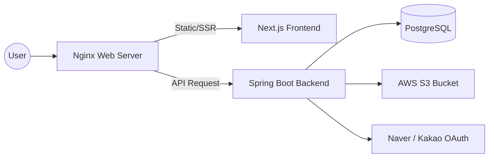

# 드림쇼콰이어 공식 홈페이지 (Dream Show Choir)

> 사회적협동조합 드림쇼콰이어의 공식 정보 제공, 단원 관리 및 커뮤니티 운영을 위한 웹 플랫폼입니다.
> 기획·DB 설계·백엔드·프론트엔드·배포를 1인으로 진행했습니다. (2025.08 ~ 2025.12, 2025.12.12 배포)

## 배포 링크
**홈페이지 바로가기 :** [https://dreamshowchoir.ulsan.kr](https://dreamshowchoir.ulsan.kr)

[접속 안내] 본 서비스는 사용자 편의와 보안 강화를 위해 Naver / Kakao 소셜 로그인만을 지원합니다. 별도의 회원가입 절차 없이, 사용하시는 계정으로 원클릭 접속하여 모든 기능을 체험하실 수 있습니다. (수집되는 정보는 이름과 이메일뿐이며, 테스트 목적 외에는 사용되지 않습니다.)

---

## Repository 구성

| 경로 | 내용 |
| :--- | :--- |
| `dungeong/` | 백엔드 (Spring Boot) |
| `frontend/` | 프론트엔드 (Next.js) |

---

## Tech Stack & Decision
프로젝트의 목적과 유지보수성을 고려하여 안정적이고 확장 가능한 기술 스택을 선정했습니다.

### Frontend
| 구분 | 기술(Stack) | 선정 이유 (Reasoning) |
| :--- | :--- | :--- |
| **Framework** | **Next.js 16.0.7** (App Router) | 합창단 홈페이지 특성상 검색 엔진 노출(SEO)이 중요하여 SSR을 지원하는 Next.js를 선택 |
| **Library** | **React 19.2.1** | 보안 패치가 적용된 버전 사용 |
| **Language** | **TypeScript** | 정적 타입 지정을 통해 런타임 에러를 방지하고 유지보수성을 높이기 위함 |
| **Styling** | **Tailwind CSS** | 별도의 CSS 파일 관리 없이 클래스명만으로 빠르게 반응형 UI를 구현하기 위함 |
| **Editor** | **React-Quill-New** | React 19 호환성 문제를 해결하고, 안정적인 Rich Text 편집 환경을 제공하기 위해 도입 |

### Backend
| 구분 | 기술(Stack) | 선정 이유 (Reasoning) |
| :--- | :--- | :--- |
| **Framework** | **Spring Boot 3.2.3** (Java 17) | 방대한 커뮤니티와 생태계를 갖춘 자바 진영 표준 프레임워크로, 안정적인 API 서버 구축 |
| **Database** | **PostgreSQL** | 복잡한 관계형 데이터 처리에 능하며 확장성이 뛰어난 오픈소스 DB |
| **Security** | **Spring Security + OAuth 2.0 + JWT** | 비밀번호 자체 관리의 보안 리스크를 제거하고, 사용자의 접근성을 높이기 위해 소셜 로그인만 허용 |
| **ORM** | **Spring Data JPA** | 반복적인 SQL 작성을 줄이고 객체 지향적인 데이터 조작을 위해 사용 |
| **Migration** | **Flyway** | DB 스키마 변경 이력을 코드로 관리해 로컬·배포 환경의 정합성을 유지 |
| **Storage** | **AWS S3** (Spring Cloud AWS) | 악보·사진·공연 영상 등 파일 저장 |

### Infrastructure
| 구분 | 기술(Stack) | 선정 이유 (Reasoning) |
| :--- | :--- | :--- |
| **Cloud** | **AWS EC2** | 서버 환경을 직접 제어하며 Nginx와 OS 수준 설정을 관리 |
| **Server** | **Nginx** | Reverse Proxy로 화면(Next.js)과 API(Spring Boot) 요청을 나누고, SSL 적용 및 대용량 파일 업로드 설정을 관리 |

---

## System Architecture


---

## Key Technical Decisions
개발 과정에서 마주친 문제들과 이를 해결하기 위한 기술적 의사결정입니다.

### 1. 로그인과 단원 권한의 분리
- **문제**: 소셜 로그인만으로 누구나 단원 전용 자료(악보·공지·게시판)에 접근해서는 안 되며, 가입 심사 이력도 남겨야 함.
- **해결**:
  - 역할을 `GUEST`(첫 로그인) → `USER`(추가 정보 입력) → `MEMBER`(관리자 승인) → `ADMIN`으로 나누고, **역할(접근 권한)**과 **가입 신청 상태(`PENDING` / `APPROVED` / `REJECTED`, 심사 기록)**를 별도로 관리.
  - 승인 시 신청 상태 변경, 역할 `MEMBER` 부여, 단원 프로필 생성, 알림 저장을 **하나의 트랜잭션**에서 처리.
  - Spring Security에서 URL 단위로 인가 (`/api/join`은 `USER`만, `/api/sheets/**`·`/api/posts/**`는 `MEMBER`·`ADMIN`, `/api/admin/**`은 `ADMIN`).

### 2. OAuth 전용 인증과 토큰 관리
- **문제**: 운영 인력이 적은 비영리 단체에서 비밀번호 저장·복구를 책임지기 어려움.
- **해결**:
  - Naver / Kakao OAuth만 허용하고 비밀번호는 보관하지 않음. OAuth 인가 요청을 세션 대신 쿠키에 저장해 서버를 STATELESS로 유지.
  - Refresh Token은 DB에 저장하고 HttpOnly 쿠키로 전달하며, 재발급 시 새 토큰으로 교체(Rotation). 만료 토큰은 매일 스케줄러로 정리.
  - 재발급 시 DB의 현재 역할로 권한을 다시 구성해, 관리자 승인 결과가 다음 재발급부터 반영되도록 함.

### 3. 탈퇴 데이터 정책과 FK 마이그레이션 트러블슈팅
- **정책**: 탈퇴 시 개인정보(가입 신청서, 단원 프로필, 게시글, 댓글, 알림, Refresh Token)는 `ON DELETE CASCADE`로 삭제하고, 단체 자산(공지, 갤러리, 악보, 활동 자료)과 후원 기록은 `ON DELETE SET NULL`로 작성자만 비우고 보존. 탈퇴 이력에 OAuth 식별자를 남겨 6개월간 재가입을 제한하고, 6개월이 지난 이력은 매일 스케줄러로 삭제.
- **문제**: 정책을 적용한 V17이 초기(V1) 제약 이름 `FK_User_TO_*`와 다른 이름으로 `DROP CONSTRAINT IF EXISTS`를 실행해, 오류 없이 건너뛰고 기존 FK가 남음 → 기존 FK가 회원 삭제를 막음.
- **해결**: 이미 적용된 V17은 수정하지 않고, V19·V20에서 옛 이름과 새 이름의 FK를 모두 제거한 뒤 정책대로 다시 지정.
- **배운 점**: `IF EXISTS`는 이름이 틀려도 성공한 것처럼 지나가므로, 제약을 바꾸기 전에 DB 카탈로그에서 실제 이름을 확인해야 함.

### 4. 대용량 미디어 업로드 처리 (Nginx + Spring Boot)
- **문제**: 고화질 공연 영상 및 배너 업로드 시, 기본 업로드 용량 제한으로 `413 Payload Too Large` 에러 발생.
- **해결**: Nginx의 `client_max_body_size`와 Spring Boot의 multipart 한도를 함께 상향(애플리케이션 한도 200MB). 한도를 넘으면 413 상태와 안내 메시지를 반환하는 예외 핸들러 추가.

### 5. DB 스키마 형상 관리 (Flyway)
- **문제**: 로컬 개발 환경과 배포 환경 간의 DB 스키마 불일치로 배포 시 에러 발생.
- **해결**: Hibernate 자동 DDL(`ddl-auto`)을 끄고 Flyway로만 스키마를 변경. 서버 실행 시 버전별 SQL(V1~V21)이 자동 적용되어 환경 간 구조를 일치시킴.

### 6. React 19 호환성 문제와 에디터 교체
- **문제**: 기존 `react-quill` 라이브러리가 더 이상 유지보수되지 않아 React 19 환경에서 `peer dependency` 충돌 및 렌더링 오류 발생.
- **해결**: React 최신 버전을 지원하는 포크 버전인 **`react-quill-new`**로 마이그레이션하고, Next.js의 `dynamic import(ssr: false)`를 적용하여 `document is not defined` 에러를 해결함.

### 7. Security & Maintenance (보안 취약점 대응)
- **Backend**: CVE 대응을 위해 Spring Boot 3.1.0 → 3.2.3 업그레이드, `snakeyaml` 2.2 버전 강제 적용.
- **Frontend**: React Server Components 원격 코드 실행(RCE) 취약점 공지(*CVE-2025-55182*, *CVE-2025-66478*)에 따라 패치 버전(**React 19.2.1**, **Next.js 16.0.7**)으로 배포.

---

## Known Limitations & Next Steps
코드를 다시 검토하며 정리한 개선 과제입니다.

- [ ] 가입 승인 시 현재 상태(`PENDING`) 확인과 동시 처리 방어(조건부 갱신 또는 행 잠금)
- [ ] 중복 가입 신청을 DB 유니크 제약으로 막고 `409 Conflict`로 응답, 거절된 사용자의 재신청 경로 마련
- [ ] 토큰 쿠키에 `Secure`, `SameSite` 속성 지정
- [ ] 탈퇴 처리에서 S3 파일 삭제와 DB 삭제의 순서·실패 처리 정리
- [ ] 가입 승인·탈퇴 흐름의 서비스 계층 통합 테스트 추가 (현재 테스트는 리포지토리 계층 중심)

---

## Key Features

| 구분 | 기능 | 설명 |
| :--- | :--- | :--- |
| **소개** | 단체 소개 | 연혁, 조직도, 오시는 길(지도 API) |
| **활동** | 갤러리 | 공연 사진 및 영상 아카이빙 (S3 연동) |
| **단원** | 전용 공간 | 악보/자료실, 연습 일정 캘린더(Google Calendar), 공지사항 (권한 관리) |
| **소통** | 커뮤니티 | 문의하기(이메일 알림, reCAPTCHA), 자유게시판·댓글 |
| **관리** | Admin | 가입 승인, 회원 권한 관리, 콘텐츠 업로드, 배너 관리, 대시보드 |

---

## 📸 Service Screens
드림쇼 콰이어 홈페이지의 주요 기능 스크린샷입니다.

### 1. Main Page & Admin
합창단의 첫인상을 주는 메인 랜드마크와 관리자 전용 대시보드입니다.

| **Main Landing Page (Hero Section)** |
| :---: |
|  |
| **합창단 소개 및 공연 정보가 담긴 메인 화면** |

<br>

| **Admin Dashboard** |
| :---: |
|  |
| **관리자 전용 배너/게시글 관리 페이지** |

<br>

### 2. Board System (React Quill New)
Rich Text 에디터를 적용하여 이미지 업로드와 스타일링이 가능합니다.

| **게시글 작성 (Write)** | **게시글 상세 (Read)** |
| :---: | :---: |
|  |  |

<br>

### 3. Authentication (Security)
OAuth2 및 JWT를 적용한 보안 로그인 프로세스입니다.

| **로그인 페이지** | **회원가입 폼** | **OAuth / 유효성 검사** |
| :---: | :---: | :---: |
|  |  |  |

<br>

### 4. Mobile Responsive
모바일 환경에서도 최적화된 레이아웃을 제공합니다.

| **모바일 메인** | **모바일 메뉴 (Hamburger)** |
| :---: | :---: |
|  |  |

---

## Getting Started

로컬 환경에서 프로젝트를 실행하는 방법입니다.

### Prerequisites

* JDK 17+
* Node.js 18+
* PostgreSQL

### 1. Clone

```bash
git clone https://github.com/dungeong/dreamshowchoir-homepage.git
cd dreamshowchoir-homepage
```

### 2. Backend (Spring Boot)

```bash
cd dungeong
./gradlew bootRun
```

DB 접속 정보, OAuth 클라이언트, JWT, S3 설정이 필요합니다. 실제 값은 저장소에 두지 않고 환경 변수나 별도 프로필로 주입합니다.

### 3. Frontend (Next.js)

```bash
cd frontend
npm install
npm run dev
```

---

## 🗄️ ERD Evolution (Database Architecture)
프로젝트 진행 과정에서 요구사항 분석과 서비스 안정성을 위해 데이터베이스 구조를 지속적으로 고도화했습니다.

### 🚀 v1.0 vs v2.0 주요 변경 사항
초기 설계 단계에서 실제 개발을 진행하며 **보안, 데이터 안정성, 유지보수성**을 고려하여 스키마를 개선했습니다.

| 구분 | 초기 기획 (Draft) | 최종 구현 (Final) | 개선 이유 및 기술적 의사결정 |
| :--- | :---: | :---: | :--- |
| **보안 (Auth)** | User 테이블 단일 | **RefreshTokens 테이블 추가** | Refresh Token을 DB에 저장해 재발급·교체·만료 정리를 서버가 관리 |
| **삭제 정책** | Hard Delete | **콘텐츠 Soft Delete + 회원 탈퇴 정책** | 게시글·공지·악보 등 콘텐츠는 논리 삭제로 복구 가능하게 하고, 회원은 탈퇴 시 개인정보를 물리 삭제하되 단체 자산은 보존 |
| **형상 관리** | 수동 관리 | **Flyway 도입** | `flyway_schema_history`를 통해 DB 스키마 변경 이력을 버전별로 관리 |
| **사용자** | User 통합 | **MemberProfile 분리** | 인증 정보(User)와 단원 부가 정보(Profile)를 분리하여 확장성 확보 |

<br>

### 📅 Initial Draft ERD (Planning Stage)
<details>
<summary>초기 기획 단계의 ERD 보기 (클릭)</summary>


</details>

<br>

### 🛠️ Final Production ERD
현재 실제 서비스에 적용된 최종 데이터베이스 구조입니다.


---

## 📝 Blog & Dev Log

백엔드 개발 과정을 기록했습니다.

http://polarized-pin-f6a.notion.site/2993293b6f8b8040aff0daf9543830d7?pvs=74

---

## 👨‍💻 Contributor

* [이동영/dungeong](https://github.com/dungeong)
